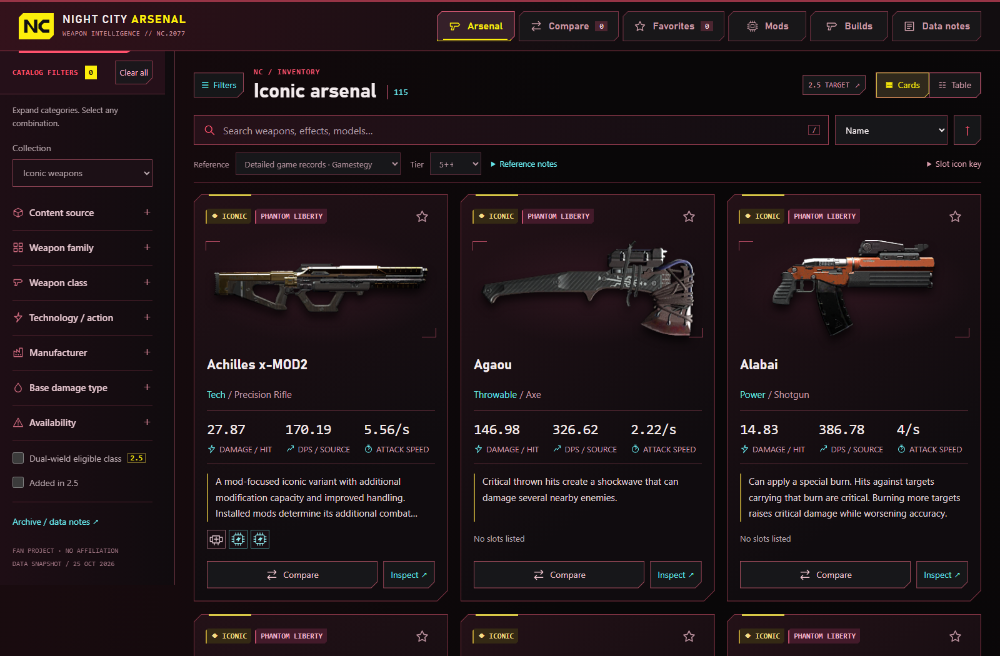
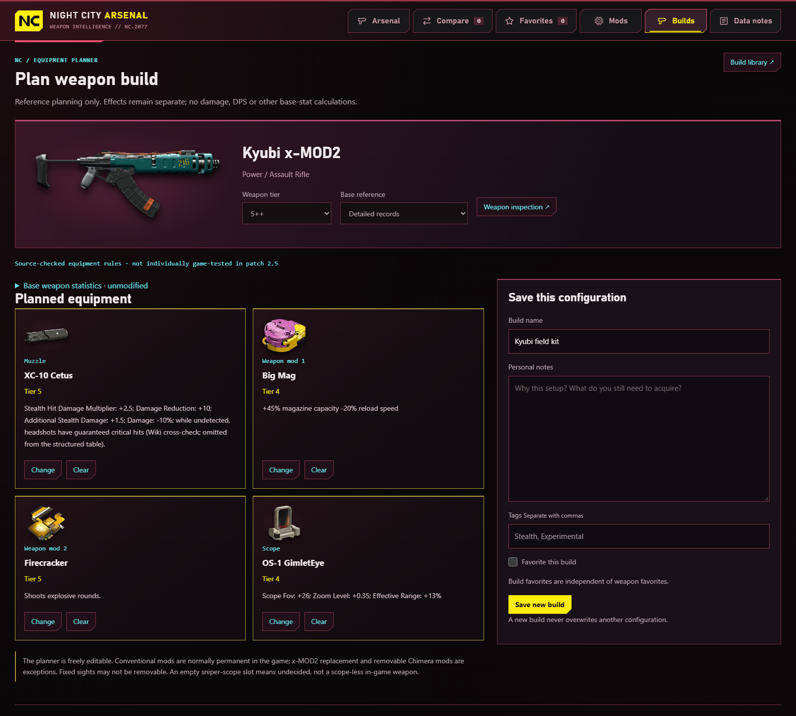

# Night City Arsenal

An offline Cyberpunk 2077 weapon reference and equipment planner. Browse weapons, compare stats, and save favorites and equipment builds.

> **AI experiment:** This is a quick personal project I wanted to try, to see what I could build with AI. **The code was written by OpenAI's Codex**, with me providing the ideas, direction, and feedback.

## Open the app

**[Open Night City Arsenal in your browser](https://evanlloydjohns.github.io/NightCityArsenal/)** on your computer or phone.

On iPhone, open that link in **Safari**, tap **Share**, then **Add to Home Screen**. Leave **Open as Web App** enabled if shown, then tap **Add**. Launch it from the new Home Screen icon and let it finish loading before using it offline.

### Download for offline use

1. **[Download Night City Arsenal](dist/Night-City-Arsenal.zip?raw=true).**
2. Extract the ZIP (on Windows, right-click it and choose **Extract All**).
3. Open the extracted folder and double-click **Night-City-Arsenal.html** to launch it in your browser.

**No installation, account, or internet connection is needed to use the app.** Everything is included in the HTML file.

Already have this repository on your computer? Open [dist/Night-City-Arsenal.html](dist/Night-City-Arsenal.html) directly in your browser. No build or setup is required. You can share the ZIP with friends using the same three steps above.

## Screenshots

Browse the weapon catalog with search, filters, and cards or a table view.



Plan compatible mods and attachments, then save your build. Planning is informational and does not recalculate weapon stats.



## Favorites and saved builds

Favorites and builds stay in your browser. Keep the same file location/browser or PWA origin when updating. Before moving, export preferences from **Data notes** and builds from **Builds > Export JSON**, then import both in the new location.

<details>
<summary>Storage recovery and moving from older versions</summary>

If another tab changes stored data, further writes in the stale tab are blocked. Export its session before reloading, then import builds to keep both versions (duplicate IDs receive new IDs). A restored draft based on an older library must be saved as new or reopened from the latest library before updating. Automatic merging is deliberately avoided.

Invalid stored data is left untouched. **Export storage recovery** in Data notes or Builds downloads a JSON envelope whose `snapshots` strings preserve the original stored text; ordinary exports contain the usable session, including individually valid recovered builds. Keep both exports before repairing the affected storage key and reloading. Completely malformed JSON cannot be partially recovered automatically. Blocked/full storage uses session-only changes and ordinary JSON exports; builds also require Web Locks for safe persistent writes.

The development restructure moved the old `outputs/Share-with-friends/` HTML to `dist/`. At that time, the offline and PWA HTML were preserved byte-for-byte. Moving the offline file may expose a separate browser preference store; export preferences and builds from the old location before switching, then import them. This change does not clear browser data. Git retains the previous paths and working edits at `refs/archive/pre-development-restructure`.

</details>

## Web app hosting

The web app is hosted on GitHub Pages at **https://evanlloydjohns.github.io/NightCityArsenal/**. The [deployment workflow](.github/workflows/pages.yml) rebuilds both distributions, verifies reproducible builds and packaging, and publishes only `dist/pwa/` when `master` is updated. It can also be run manually from GitHub Actions.

The [PWA files](dist/pwa/) and [PWA ZIP](dist/Night-City-Arsenal-PWA.zip?raw=true) remain available for other HTTPS hosting. Keep the same HTTPS URL, manifest identity, and scope when updating an existing installation to preserve access to browser data. Downloads and the hosted app have separate browser storage; export/import preferences and builds to transfer them. For local PWA development, see below.

## Development

| Path | Purpose |
|---|---|
| `src/` | Readable HTML, CSS, JavaScript, canonical JSON and original artwork |
| `src/pwa/` | Manifest, worker/client sources, shell fragments and install icons |
| `tools/` | Build/package command and optional local PWA preview |
| `tests/` | Build reproducibility, planner, catalog, equipment, storage, distribution and PWA checks |
| `dist/` | Generated offline HTML, PWA folder and both sharing ZIPs |

Edit source, then build from the repository root:

```powershell
python tools/build.py
```

Python 3.9+ and its standard library are sufficient. The command also works from another directory when given the script's absolute path. `--output SOME_FOLDER` selects a separate output folder. Builds use no network and include all artwork/data. ZIPs are deterministic, contain only their product files, and are tracked alongside the tested HTML. Source documentation and validation reports are development materials and are not shipped in either ZIP; the application includes source links and verification notes.

`src/data/weapons.json` and `modifications.json` contain the reviewed application data. Their `image.src` values reference `src/assets/`; the build verifies image-manifest checksums and embeds the bytes. Equipment presentation rules are in `modifications.json` under `meta.display`. Preserve IDs, storage keys and source uncertainty. Planning never recalculates weapon statistics.

JavaScript stays in small inline scripts embedded by the Python build. `presentation.js` supplies shared formatting and `storage.js` guards the existing storage keys. `catalog.js` owns pooled catalog nodes, reconciliation and offscreen containment; `app.js` supplies live state, templates and selection patches, and coordinates navigation, inspection and delegated events. `planner-core.js` supplies equipment rules. `build-library.js` owns the saved-build session, validation, partial recovery and filtering; `expansion.js` coordinates equipment UI, draft revisions and delegated build actions.

The template loads presentation/storage/catalog before running `app.js`, then planner core/build library before running `expansion.js`. Module factories declare their dependencies explicitly and initialize only when the entry point calls them. State getters keep the catalog current when preferences are replaced by import/reset; build-library reads always use its current session. `window.Arsenal` and `window.NCAExpansion` retain the public inspection helpers used by the checks and PWA update guards.

For local PWA development, run `python tools/preview.py` and visit `http://localhost:8765/`. It serves only `dist/pwa/` on loopback; Ctrl+C stops it. Keep the same origin/port to preserve its storage and installation identity. Installed offline caches can be evicted; retain JSON backups. Headless checks do not establish Windows Start/taskbar integration.

## Checks

Tests need Node.js 20+ and development-only Playwright:

```powershell
npm ci
npm test
```

Windows tests use installed Microsoft Edge when available. On other systems, first run `npx playwright install chromium`. `BROWSER_EXECUTABLE`, `PLAYWRIGHT_MODULE` and `PYTHON_EXECUTABLE` can select existing local tools; the shipped products need none of these dependencies.

Run only relevant suites for ordinary changes:

```powershell
npm test -- build planner-core distribution
npm test -- pwa
```

Available suites: `build`, `planner-core`, `app`, `mod-detail`, `modifications-ui`, `equipment-ux`, `build-storage`, `distribution`, `pwa`. Browser checks run headless with GPU/compositing disabled and isolated storage. All reports, downloads, screenshots and browser profiles go to ignored `.tmp/`. Research caches, collectors and historical visual/performance audits remain removed; prior development is recoverable from Git.
